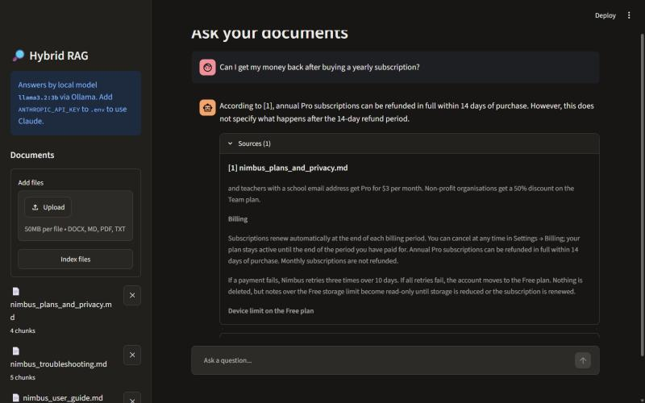
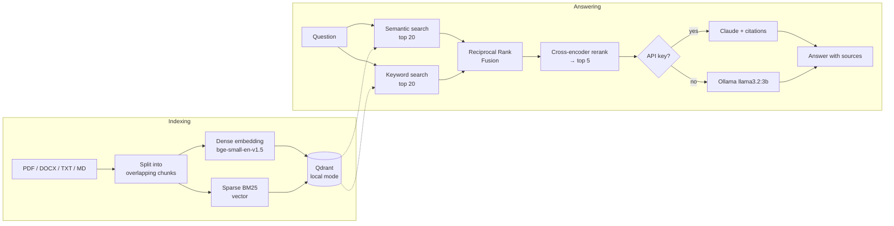

# Hybrid RAG

Ask questions about your own documents and get answers with citations.

Retrieval is **hybrid**: a semantic (embedding) search and a keyword (BM25) search run side by side, their results are merged with **Reciprocal Rank Fusion**, and a **cross-encoder reranks** the best candidates. The answer is then written by **Claude** with built-in citations, or by a **local model through Ollama** when no API key is set, so the whole app also runs offline for free.



## Features

- **Hybrid retrieval**: semantic + BM25 search, RRF fusion, cross-encoder reranking
- **Cited answers**: every claim links back to the passage it came from
- **Two answer models**: Claude (API key) or a local Llama model via Ollama (no key needed), picked automatically
- **Streamlit chat UI**: upload PDF/DOCX/TXT/MD files, streaming answers, source passages, and per-stage retrieval scores
- **Measured, not assumed**: an evaluation script compares all four retrieval modes
- **Runs locally**: embeddings, reranker and vector database ([Qdrant](https://qdrant.tech) in local mode) need no server or GPU

## How it works



1. **Ingest**: files are split into ~800-character chunks that overlap by ~150 characters and break at paragraph or sentence boundaries. PDFs are split page by page so citations show page numbers. Each chunk gets a dense vector (meaning) and a sparse BM25 vector (exact words).
2. **Search**: the question runs through both searches. RRF merges the two lists using only ranks, so their very different score scales never need normalising.
3. **Rerank**: a small cross-encoder (`ms-marco-MiniLM-L-12-v2`) reads each question–passage pair together and re-scores the top 20.
4. **Answer**: the top 5 passages go to the model, which must answer only from them and otherwise say it couldn't find the answer.
   - **Claude** receives each passage as a `document` block with citations enabled, so the citations come from the API itself.
   - **The local model** sees numbered passages and cites them as `[n]`. Invalid numbers are removed.

## Does hybrid search help?

[eval.py](eval.py) runs 22 labelled questions ([eval_questions.json](eval_questions.json)) against the sample documents in every retrieval mode. Each question names a phrase that the correct passage contains. No language model is involved, so results are the same on every run.

| Mode | Hit@1 | Hit@3 | MRR | Avg search time |
|---|---|---|---|---|
| semantic | 64% | 91% | 0.78 | 9 ms |
| keyword | 68% | 82% | 0.75 | 1 ms |
| hybrid | 77% | 95% | 0.87 | 9 ms |
| **hybrid_rerank** | **82%** | **100%** | **0.91** | 1063 ms |

Hit@1 split by question type:

| Mode | Exact terms, e.g. `NB-1004` (10) | Reworded questions (12) |
|---|---|---|
| semantic | 80% | 50% |
| keyword | 100% | 42% |
| hybrid | 100% | 58% |
| hybrid_rerank | 100% | 67% |

- **Keyword search** is perfect on exact terms like error codes but weak when the question uses different words than the document.
- **Semantic search** is the reverse.
- **Hybrid** gets the best of both, and **reranking** puts the right passage first more often, at the cost of about one second per query on a CPU.

The sample set is small (3 documents, 14 chunks), so treat these numbers as a demonstration rather than a benchmark. Full tables are in [eval_results.md](eval_results.md).

## Quick start

**Requirements:** Python 3.12+ and [uv](https://docs.astral.sh/uv/) (`pip install uv`). For answers you also need **one** of:

- a Claude API key from [console.anthropic.com](https://console.anthropic.com), or
- [Ollama](https://ollama.com) with a local model: `ollama pull llama3.2:3b` (about 2 GB, runs on CPU)

```bash
git clone <this-repo> && cd rag-app
uv sync
cp .env.example .env        # Windows: copy .env.example .env
                            # then add ANTHROPIC_API_KEY, or leave it empty to use Ollama
uv run streamlit run app.py
```

Open http://localhost:8501 and click **Load sample documents** in the sidebar, or upload your own files. The first run downloads the embedding and reranker models (about 200 MB) into `data/models/`.

Example questions for the sample documents:

- *What does error NB-4012 mean and how do I fix it?*
- *Can I get my money back after buying a yearly subscription?*
- *Does Nimbus Notes support video calls?* (not in the documents, so it should say so)

The sample documents describe **Nimbus Notes**, a fictional app written for this demo.

## Command line

```bash
# Index files or folders (skips unchanged files; --reset clears the index first)
uv run python -m rag.ingest sample_data

# Search only, printing every stage's score
uv run python -m rag.retrieve "What does error NB-4012 mean?" --mode hybrid_rerank

# Search + answer
uv run python -m rag.generate "Can I get a refund on a yearly plan?" --provider ollama

# Compare retrieval modes
uv run python eval.py
```

Retrieval modes: `semantic`, `keyword`, `hybrid`, `hybrid_rerank`.

## Configuration

All settings can go in `.env` (see [.env.example](.env.example)):

| Variable | Default | Meaning |
|---|---|---|
| `ANTHROPIC_API_KEY` | empty | Claude API key; if empty, Ollama is used |
| `LLM_PROVIDER` | `auto` | `auto`, `claude` or `ollama` |
| `CLAUDE_MODEL` | `claude-opus-5-5` | Claude model |
| `CLAUDE_EFFORT` | `medium` | `low` is faster and cheaper, `high` is more thorough |
| `OLLAMA_MODEL` | `llama3.2:3b` | any model you've pulled with Ollama |
| `OLLAMA_HOST` | `http://localhost:11434` | Ollama server address |
| `CHUNK_SIZE` / `CHUNK_OVERLAP` | `800` / `150` | chunk length and overlap in characters |
| `TOP_K` | `5` | passages sent to the answer model |

## Project structure

```
rag/
  config.py     settings from .env
  ingest.py     load files, chunk, embed, store; list/delete documents
  store.py      Qdrant client and the local embedding/rerank models
  retrieve.py   semantic + keyword search, RRF fusion, reranking
  generate.py   cited answers from Claude or a local Ollama model
app.py          Streamlit UI
eval.py         retrieval evaluation (eval_questions.json -> eval_results.md)
sample_data/    fictional demo documents
tests/          unit tests + an end-to-end test with the real models
```

## Tests

```bash
uv run pytest                    # everything (first run downloads ~200 MB of models)
uv run pytest -m "not integration"   # fast unit tests only
uv run ruff check . && uv run ruff format --check .
```

Language-model calls are tested with fake clients, so the tests need no API key and no Ollama. CI runs lint and the full test suite on every push.

## Limitations

- Qdrant runs in local (embedded) mode, which allows one process at a time. Stop the Streamlit app before running the CLI on the same index.
- The local 3B model is slow on CPU (about 30–40 s per answer) and sometimes phrases things awkwardly. Claude is faster and more precise.
- Scanned PDFs need OCR first; only PDFs with a text layer are supported.

## License

[MIT](LICENSE)
